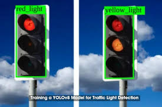

# 🚦 Traffic Light Detection
### Real-Time Computer Vision | YOLOv8 | PyTorch | CinTA_v2

Traffic Light Detection is a computer vision project designed to detect and classify traffic lights using the **YOLOv8 object detection architecture**.

The project utilizes the CinTA_v2 dataset and PyTorch-based deep learning workflows to identify traffic light states, including Red, Yellow, and Green.

It explores applications in intelligent transportation systems, traffic monitoring, and autonomous driving research.

---

## ✨ Key Features

- 🚦 **Traffic Light Detection**
  - Detects traffic lights in images and videos.
  - Identifies Red, Yellow, and Green traffic light states.
  - Supports video files and webcam input, depending on the configured inference pipeline.

- 🧠 **YOLOv8 Object Detection**
  - Built using the Ultralytics YOLOv8 framework.
  - Uses the CinTA_v2 dataset for traffic light detection.
  - Supports custom-trained detection weights.

- 🎥 **Video Inference**
  - Processes video files.
  - Generates visual detection results.
  - Supports extension to real-time camera applications.

- 🚀 **Extensible Architecture**
  - Can be extended to detect additional traffic signs.
  - Can be integrated into intelligent transportation systems.
  - Provides a foundation for further computer vision development.

---

## 🏗️ Project Workflow

```text
       Input Image / Video
                |
                v
       Image Preprocessing
                |
                v
          YOLOv8 Model
                |
                v
       Object Detection
                |
                v
      Traffic Light Classes
                |
       +--------+--------+
       |        |        |
       v        v        v
      Red     Yellow    Green
       |        |        |
       +--------+--------+
                |
                v
       Bounding Box Display
                |
                v
       Detection Results
```

---

## 📊 Dataset

**CinTA_v2 Dataset**

The project uses the CinTA traffic light dataset for object detection training and experimentation.

- Dataset Platform: Roboflow Universe
- Dataset: CinTA
- Main Task: Traffic Light Detection
- Classes: Red, Yellow, Green

🔗 **Dataset Source:**

[CinTA Dataset – Roboflow Universe](https://universe.roboflow.com/wawan-pradana/cinta-0e3en)

**Dataset Attribution:**

The dataset is provided by its respective creators on Roboflow Universe. All dataset ownership and licensing rights remain with the original authors.

Users must review the dataset's applicable license and terms before downloading, redistributing, or using it commercially.

---

## 🛠️ Technologies & Tools

| Technology | Purpose |
|---|---|
| Python | Programming Language |
| YOLOv8 | Object Detection |
| Ultralytics | YOLO Framework |
| PyTorch | Deep Learning Framework |
| CinTA_v2 | Training Dataset |
| OpenCV | Computer Vision / Video Processing |

---

## 📦 Installation

### 1. Clone the Repository

```bash
git clone https://github.com/Mahmoud3301/traffic_light.git

cd traffic_light
```

### 2. Install Dependencies

```bash
pip install -r requirements.txt
```

### 3. Run Detection

```bash
python test_traffic_light.py --weights yolov8n.pt --source test1.mp4
```

**Note:** Make sure the required model weights, dataset files, and input videos are available in their expected locations.

---

## 🖼️ Project Preview



---

## 🚀 Future Improvements

- Improve detection performance in challenging lighting conditions.
- Expand detection to additional traffic signs and road objects.
- Optimize inference speed for real-time applications.
- Deploy the detection pipeline as a web or mobile application.
- Integrate with intelligent transportation and autonomous driving systems.

---

## ⚠️ Limitations & Responsible Use

- Detection performance depends on dataset quality, model training, and environmental conditions.
- Lighting, weather, occlusion, and camera quality may affect predictions.
- Model predictions should not be treated as the sole basis for safety-critical driving decisions.
- Any real-world deployment requires additional testing and safety validation.

---

## 📜 Licensing & Intellectual Property

### Original Project Contributions

Copyright (c) 2026 Mahmoud Saeed Mansour.

The original project contributions are attributed to their respective authors.

This repository is distributed under the **GNU Affero General Public License v3.0 (AGPL-3.0)**, subject to the applicable rights and licenses of third-party components.

### Third-Party Components

| Component | Original Source | License |
|---|---|---|
| YOLOv8 | [Ultralytics](https://github.com/ultralytics/ultralytics) | AGPL-3.0 |
| PyTorch | [PyTorch](https://github.com/pytorch/pytorch) | BSD-style |
| OpenCV | [OpenCV](https://github.com/opencv/opencv) | Apache 2.0 (4.5.0+) |
| CinTA Dataset | [Roboflow Universe](https://universe.roboflow.com/wawan-pradana/cinta-0e3en) | Check original dataset terms |

### Important Licensing Notice

- The original authors retain ownership of their respective contributions.
- Ultralytics YOLOv8 and its associated models remain subject to their applicable licensing terms.
- Dataset ownership and usage rights belong to the original dataset creators.
- Third-party licenses are not replaced or overridden by this repository's license.
- Commercial or proprietary deployment involving Ultralytics YOLOv8 may require an appropriate Ultralytics Enterprise License.

For further information:

[Ultralytics Licensing](https://www.ultralytics.com/license)

[GNU AGPL-3.0](https://www.gnu.org/licenses/agpl-3.0.html)

---

## 👨‍💻 Developed By

**Mahmoud Saeed Mansour**

AI & Machine Learning Engineer | Computer Vision | Deep Learning | NLP | RAG

- GitHub: [@Mahmoud3301](https://github.com/Mahmoud3301)
- LinkedIn: [Mahmoud Saeed Mansour](https://www.linkedin.com/in/mahmoud-saeed-928623252/)
- Portfolio: [Personal Portfolio](https://mahmoud3301.github.io/mypersonalweb/)

---

## © Copyright Notice

© 2026 Mahmoud Saeed Mansour.

All rights to original project contributions are attributed to their respective authors and remain subject to the applicable open-source and third-party licensing terms.

This notice does not claim ownership of third-party software, pretrained models, datasets, or external resources.
